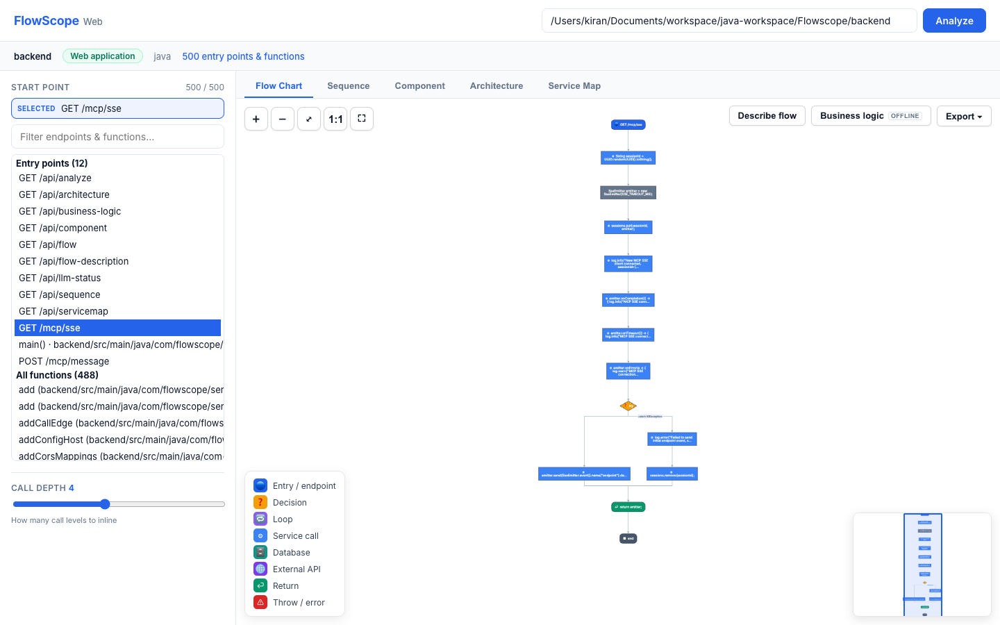
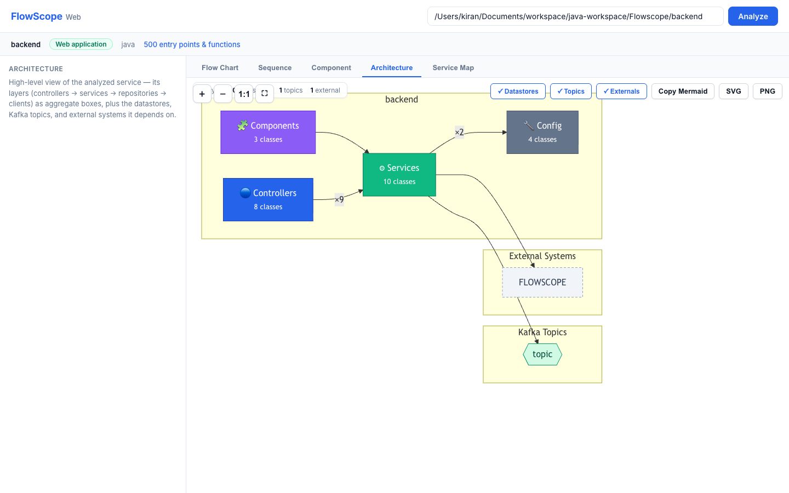
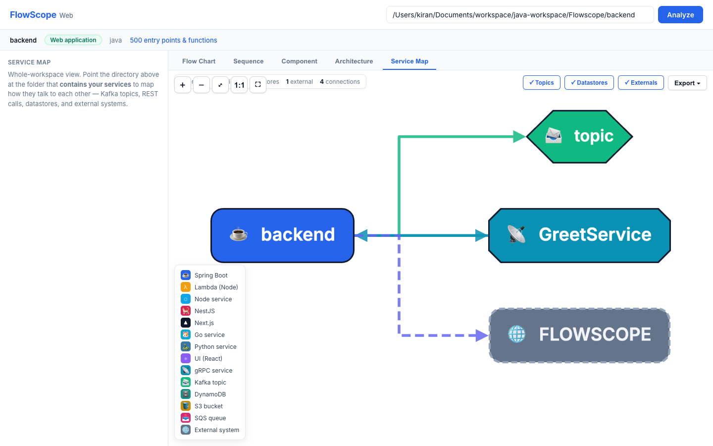
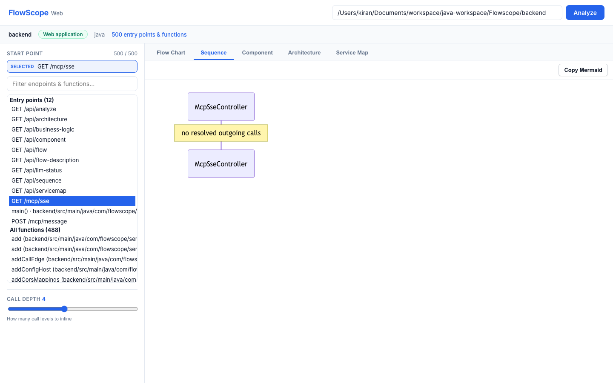
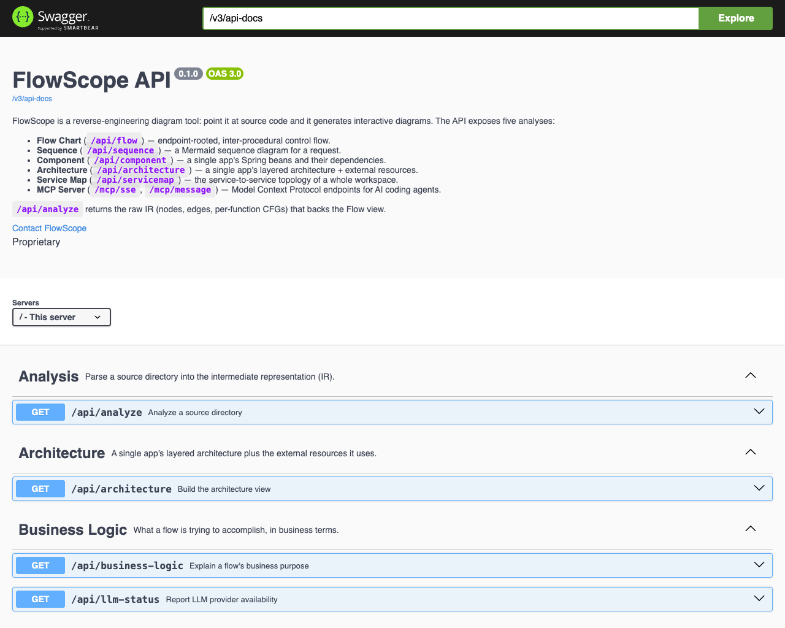

# FlowScope Web

**Reverse-engineering diagram tool — point it at source code and it generates interactive diagrams.**

FlowScope parses a codebase into a language-neutral intermediate representation (IR)
and renders five complementary views of it, from a single function up to a whole
workspace of microservices. Think draw.io, except the diagrams are derived from the
code and stay true to it.

| # | Diagram | Scope | Answers |
|---|---------|-------|---------|
| 1 | **Flow Chart** | one function | How does this request flow, end to end (inter-procedural, calls inlined)? |
| 2 | **Sequence** | one function | Which components talk, in what order, for this request? |
| 3 | **Component** | one app | What are this service's Spring beans and how do they depend on each other? |
| 4 | **Architecture** | a project or one app | Project: how do all its services, messaging, data stores and external systems fit together? One app: what are its layers, and what does each layer connect to? |
| 5 | **Service Map** | a workspace | How do all the services talk — Kafka, REST, shared datastores, external systems? |

The Flow Chart also explains itself in prose: **Describe flow** walks the graph step by step,
and **Business logic** says what the flow accomplishes — offline by default, or via an LLM
provider if you configure one (see **[LLM provider](#llm-provider-optional)**).

- **Backend:** Java 21 · Spring Boot 3.4 · [JavaParser](https://javaparser.org/) for Java · [tree-sitter](https://tree-sitter.github.io/) for Go and Python (both pure-JVM — no external toolchain).
- **Frontend:** Vite · React · TypeScript · Cytoscape.js (flow/component/architecture/service map) · Mermaid (sequence).
- **Languages:** **Java, Go, and Python** are parsed into the IR, so all five diagrams work for each. Go and Python classification is naming-convention based rather than annotation-driven, so their Component/Architecture views are shallower than Java's.
- **Service Map** additionally covers **Node/TypeScript, NestJS, Next.js, and React** by extracting communication primitives (Kafka, REST, gRPC, datastores) with targeted patterns — no full TS AST required.

---

## Screenshots

### Interactive Control Flow Graph & Function Explorer


### Whole-project Architecture View


### Workspace Service Map Topology


### Component Sequence Diagram


### OpenAPI & Model Context Protocol (MCP) Endpoints


---

## Quick start

The backend (REST API) and frontend (web UI) are **independent projects** — build and
run them separately.

**Prerequisites:** JDK 21+, Maven, and Node 22.

```bash
# 1. Backend — pure REST API on :8080
mvn -f backend/pom.xml clean package
java -jar backend/target/flowscope-web.jar

# 2. Frontend — Vite dev server on :5173 (in a second terminal)
cd frontend
npm install
npm run dev            # proxies /api → :8080
```

Open **<http://localhost:5173>**, paste an absolute source directory, and click **Analyze**.

- Single application → use **Flow Chart / Sequence / Component**.
- **Architecture**: the folder decides the scope.
  - A folder with several services shows the **whole project** in columns: front ends, APIs,
    processing, messaging, data stores, external systems and cloud services.
  - One service's folder shows **that application**: its components grouped by layer (entry points,
    business logic, data access), one Kafka box listing its topics, and the services, queues, data
    stores, external systems and cloud services it connects to. Each connection starts at the layer
    whose code makes it (found from the file:line evidence). Components by layer need a Java, Go or
    Python app; for other runtimes the connections attach to the application box.
  - Each box has an icon for its technology (AWS services, Spring Boot, PostgreSQL, Kafka, React, …).
    The view exports to PNG, SVG and an editable draw.io file that uses draw.io's own AWS shapes.
    Icon sources and licences: [`frontend/src/icons/NOTICE.md`](frontend/src/icons/NOTICE.md).
- A folder that *contains* multiple services → use **Service Map**.

> **Backend on a different port?** Start it with `PORT=8097 java -jar …` and point the
> dev proxy at it: `VITE_PROXY_TARGET=http://localhost:8097 npm run dev`.

### Production build

```bash
# Backend jar (API only — does not serve the UI)
mvn -f backend/pom.xml clean package

# Frontend static bundle → frontend/dist/, deploy behind any static host
cd frontend && npm run build
```

For production the SPA calls the API cross-origin, so set:

- `VITE_API_BASE_URL` (frontend build) → the backend's public URL.
- `flowscope.cors.allowed-origins` (backend) → the frontend's origin(s).

### Interactive docs & health (on the backend)

| URL | What |
|-----|------|
| `/swagger-ui.html` | Interactive API explorer (OpenAPI 3) |
| `/v3/api-docs` | Raw OpenAPI JSON |
| `/actuator/health` | Liveness/readiness |
| `/actuator/info` | Build & runtime info |
| `/actuator/metrics` | Micrometer metrics |

---

## API

All endpoints return `application/json`; failures return `{ "error": "..." }` with an
appropriate status (mapped centrally by `GlobalExceptionHandler`). Full request/response
schemas are in **Swagger UI**.

| Method & path | Purpose |
|---|---|
| `GET /api/analyze?path=` | Walk + parse a directory → IR (`nodes`, `edges`, per-function `cfgs`). |
| `GET /api/flow?path=&functionId=&maxDepth=` | Endpoint-rooted inter-procedural flow chart (CFG). Depth 1–8 (default 4). |
| `GET /api/flow-description?path=&functionId=&maxDepth=` | The same flow as a step-by-step walkthrough in execution order, with decisions and their branches. |
| `GET /api/business-logic?path=&functionId=&maxDepth=` | What the flow *accomplishes* — phases, rules enforced, caveats. Uses the configured LLM provider when available, else offline heuristics; the `origin` field says which. |
| `GET /api/llm-status` | Whether an LLM provider is configured, plus a non-secret label for it. Never returns the API key. |
| `GET /api/sequence?path=&functionId=&maxDepth=` | Mermaid sequence diagram. Depth 1–20 (default 10). |
| `GET /api/component?path=` | One app's beans + injection/call dependencies. |
| `GET /api/architecture?path=&exclude=` | `scope: project` for a folder with several services (columns: front ends, APIs, processing, messaging, data stores, external, cloud). `scope: application` for one service's folder: `app` holds its layers and components, and connections start at the layer group whose code makes them. |
| `GET /api/servicemap?path=&exclude=` | Whole-workspace service topology. Every edge carries a `confidence` and file:line `evidence`. |
| `POST /mcp` | **MCP Server** Streamable HTTP transport (protocol 2025-03-26+). |
| `GET /mcp/sse` | **MCP Server** legacy HTTP+SSE stream (protocol 2024-11-05). |
| `POST /mcp/message?sessionId=` | **MCP Server** legacy JSON-RPC message endpoint paired with `/mcp/sse`. |

The server binds to `127.0.0.1` by default (`FLOWSCOPE_BIND_ADDRESS` to change it). Set
`FLOWSCOPE_ALLOWED_ROOTS` (comma-separated directories) to restrict which paths the API and
MCP tools may read. Browser requests to the MCP endpoints must come from a loopback origin or
one listed in `flowscope.cors.allowed-origins`.

Common statuses: **400** missing/invalid `path` · **404** unknown `functionId` ·
**500** internal / heap exceeded · **504** analysis timed out.

---

## Model Context Protocol (MCP) Server

FlowScope runs as a first-class **Model Context Protocol (MCP)** server, enabling AI coding agents (Claude Desktop, Antigravity, Cursor, Windsurf, Cline) to query codebase architecture, trace call graphs, generate Mermaid sequence diagrams, and explore cross-service topologies directly.

### Transports

1. **STDIO** (desktop AI assistants launching FlowScope as a subprocess):
   ```bash
   java -jar backend/target/flowscope-web.jar --mcp
   ```
   With `--mcp` no web server starts, so no network port opens. Add `--mcp-http` to also
   serve the HTTP endpoints below (bound to `127.0.0.1`).

2. **Streamable HTTP** (protocol 2025-03-26 and later) when the backend runs as a web server:
   ```
   http://127.0.0.1:8080/mcp
   ```

3. **Legacy HTTP+SSE** (protocol 2024-11-05 clients): `http://127.0.0.1:8080/mcp/sse`.

`initialize` answers with the client's requested protocol version when it is one of
2025-06-18, 2025-03-26 or 2024-11-05.

### Available MCP Tools

| Tool | Parameters | Description |
|---|---|---|
| `flowscope_analyze` | `path`, `format?` | Modules, languages, counts and entry points with their `functionId`s (`format=json` for the whole IR). |
| `flowscope_find_entry_points` | `path`, `query?` | Endpoints and functions matching a path/name, with the `functionId` for the flow tools. |
| `flowscope_flow` | `path`, `functionId`, `maxDepth?` | Get inter-procedural CFG with inlined callee methods. |
| `flowscope_flow_description` | `path`, `functionId`, `maxDepth?` | Step-by-step human-readable execution walkthrough. |
| `flowscope_sequence` | `path`, `functionId`, `maxDepth?` | Complete Mermaid `sequenceDiagram` markdown with participant list. |
| `flowscope_component` | `path` | Spring beans classified by layer with dependency injection & call edges. |
| `flowscope_architecture` | `path`, `exclude?`, `format?` | Project folder: services by role, queues, data stores, external and cloud services, and their connections. One service's folder: that application's layers and components, its Kafka topics, and what each layer connects to. Default `summary`, or `json`. |
| `flowscope_servicemap` | `path`, `exclude?`, `format?`, `service?`, `kind?`, `confidence?` | Workspace topology. Default `summary`: one line per edge, `source -kind-> target label [confidence] file:line`. Also `mermaid` and compact `json`. |
| `flowscope_business_logic` | `path`, `functionId`, `maxDepth?` | Narrative explanation of business intent, rules enforced, and phases. |
| `flowscope_llm_status` | none | Check whether an external LLM is configured for narrative generation. |

JSON results are compact (not pretty-printed) to fit agent tool-output limits.

### Configuration Example (`claude_desktop_config.json`)

```json
{
  "mcpServers": {
    "flowscope": {
      "command": "java",
      "args": [
        "-jar",
        "<FLOWSCOPE_HOME>/backend/target/flowscope-web.jar",
        "--mcp"
      ]
    }
  }
}
```

---

## Reading the service map

Every arrow says how FlowScope knows about it:

| Confidence | Meaning | Drawn as |
|---|---|---|
| `declared` | Stated in `flowscope.yml` | solid, thick |
| `code` | Call site found and its target resolved | solid |
| `config` | A config value that code reads | dashed |
| `inferred` | Matched by host/name tokens or URL route | dotted |
| `unresolved` | A call was found but its target name was not; drawn as a grey placeholder | grey dotted |

Click an arrow to see its evidence (file, line, snippet, and how it was matched). Other rules:

- A URL in config becomes an arrow only when code reads its key. Unread base-url keys are
  listed in the notes as *configured but never read by code*.
- A URL that code only formats into strings (links in e-mails, redirects) is a `reference`
  edge, not a `rest` call.
- Datastore direction is decided per call (`GetCommand` reads, `PutItemCommand` writes,
  repository `save` writes, …) and per table; `uses` means the direction is unknown.
- Test, mock, fixture and non-production environment files (`environment.dev.ts`,
  `config.stage.js`, …) are ignored.
- A module that another workspace module depends on, or that isn't packaged as an
  executable, is a library.
- A table, bucket or queue passed through helpers is followed to its source: a method
  parameter to its call sites, a field to the constructor arguments (`super(...)`, `new X(...)`),
  and a config-object property to the object literals that set it.
- A Lambda package that exports several handlers shows one node per handler. A handler gets
  a Kafka topic only when its own code calls the producer method that sends it.
- Env files for one deployment of a package (`.env.device-prod`, `.env.prod-eu`) count as
  production config when there is no plain `.env.prod`.

### Override file (`flowscope.yml`)

Put an optional `flowscope.yml` at the workspace root for facts that live outside the code.
Edges it adds have confidence `declared` and point back at the file.

```yaml
hosts:            # host or host+path → service or external system
  api.example.com/admin/*: reports-dashboard
triggers:         # service[:handler] → topics / queues / schedule
  orders-lambda:commandConsumer: { consumes: [orders-commands] }
externals:        # host or host+path → system name
  partner.example.com: Partner Billing API
ignore: [legacy/, sandbox/]
```

---

## Architecture (pipeline)

```
Source dir ─► FileWalker ─► ParserEngine ─► JavaProgramModel / IRBuilder ─► REST API ─► React views
                (skip-list,     (JavaParser)    (+ type-aware call            (Cytoscape / Mermaid)
                 symlink-safe)                    resolution, cached)
```

The backend follows a standard Spring **layered package** structure under `com.flowscope`:

| Layer | Package | Contents |
|---|---|---|
| Controllers | `controller` | the 7 REST controllers |
| Services | `service` | `*Service` plus all builders/engines/registries/scanners (`JavaExtractor`, `IRBuilder`, `ComponentMapBuilder`, `ArchitectureBuilder`, `WorkspaceScanner`, `ConfigIndex`, `ServiceMapBuilder`, `FlowDescriptionService`, `BusinessLogicHeuristic`, `LlmClient`, …) |
| Domain model | `entity` | `JavaProgramModel`, `Graph`, `IRNode`, `IREdge`, `CFG`, enums, `SourceFile`, `LanguageSpec`, … |
| API responses | `dto` | `Architecture`, `ComponentMap`, `ServiceMap`, `SequenceDiagram`, `FlowDescription`, `BusinessLogic`, `ErrorResponse` |
| Error handling | `exception` | `GlobalExceptionHandler`, `ApiExceptions` |
| Configuration | `config` | `OpenApiConfig`, `LanguageConfig`, `CorsConfig`, `LlmProperties` |
| Utilities | `util` | `TextUtil`, `SpringEndpoints` |
| Frontend | `frontend/src/` | one `*View.tsx` per diagram, `api.ts`, `types.ts` |

`FlowScopeApplication` sits at the `com.flowscope` root (Spring component-scan base).

See **[docs/ARCHITECTURE.md](docs/ARCHITECTURE.md)** for design detail and **[docs/DEPLOYMENT.md](docs/DEPLOYMENT.md)** for the production checklist.

### Extending to a new language

Implement `Extractor` and register a `LanguageSpec` in `com.flowscope.config.LanguageConfig`.
The walker, IR, and CFG models are language-neutral and need no changes. The Service
Map's comm extraction is pattern-based and already spans Java + Node/TypeScript.

---

## Configuration

Config lives in `backend/src/main/resources/application.properties` and can be
overridden by environment variables or JVM args (standard Spring Boot relaxed binding).

| Property | Default | Notes |
|---|---|---|
| `PORT` / `server.port` | `8080` | HTTP port |
| `flowscope.cors.allowed-origins` | `http://localhost:5173` | Comma-separated browser origins allowed to call `/api/**` |
| `spring.mvc.async.request-timeout` | `190000` | Cap for slow workspace scans (ms) |
| `management.endpoints.web.exposure.include` | `health,info,metrics` | Exposed actuator endpoints |
| `server.compression.enabled` | `true` | Gzip large JSON payloads |
| `server.shutdown` | `graceful` | Drain in-flight requests on stop |

Analysis guards (in `AnalysisService` / `ServiceMapService`): 120 s per-analysis timeout,
2 GB heap ceiling, and an LRU cache of parsed program models keyed by source root.

---

## LLM provider (optional)

The Flow Chart's **Business logic** button explains what a flow *accomplishes* rather than
what it executes. It works two ways, and always tells you which one produced the answer:

| Origin | When | What you get |
|---|---|---|
| **Offline** (default) | No provider configured | Phases grouped by concern (validation, lookup, persistence, messaging, external, error…) and the business rules the code enforces, inferred from naming and control flow. Deterministic, free, no network. |
| **LLM** | A provider is configured | An interpretation of *intent* — what real-world operation this performs and why. |

Offline analysis reports what the code **touches**; only the LLM path explains **why**. The
UI badges each result (`Offline` / `LLM`) so the two are never mistaken for each other.

**FlowScope is provider-neutral — no vendor SDK, and no extra Maven dependency.** It speaks
two wire formats over plain HTTP, so any endpoint implementing either works: hosted APIs,
corporate gateways, or a local model.

### Configuring it

Config lives in the same `application.properties`, with every value reading from an
environment variable. **Nothing needs editing or rebuilding — export and restart the jar.**

All of these are env-overridable through Spring Boot's relaxed binding (`flowscope.llm.max-tokens`
← `FLOWSCOPE_LLM_MAX_TOKENS`); the four most-used ones are wired to explicit placeholders in
`application.properties` so they're obvious.

| Property | Env var | Default | Notes |
|---|---|---|---|
| `flowscope.llm.enabled` | `FLOWSCOPE_LLM_ENABLED` | `true` | Master switch; `false` forces offline even with a key set |
| `flowscope.llm.base-url` | `FLOWSCOPE_LLM_BASE_URL` | *(blank)* | Full URL of the completion endpoint |
| `flowscope.llm.api-key` | `FLOWSCOPE_LLM_API_KEY` | *(blank)* | **Blank ⇒ offline heuristics.** Prefer the env var over committing a key |
| `flowscope.llm.model` | `FLOWSCOPE_LLM_MODEL` | *(blank)* | Model id, passed through verbatim |
| `flowscope.llm.wire-format` | `FLOWSCOPE_LLM_WIRE_FORMAT` | `chat_completions` | `chat_completions` (OpenAI-style) or `messages` (Anthropic-style) |
| `flowscope.llm.auth-scheme` | `FLOWSCOPE_LLM_AUTH_SCHEME` | `bearer` | `bearer` · `api_key_header` (`x-api-key`) · `azure_api_key` (`api-key`) · `none` |
| `flowscope.llm.extra-header` | `FLOWSCOPE_LLM_EXTRA_HEADER` | *(blank)* | One extra `Name: value` header some gateways require |
| `flowscope.llm.max-tokens` | `FLOWSCOPE_LLM_MAX_TOKENS` | `2000` | Upper bound on generated tokens |
| `flowscope.llm.timeout-seconds` | `FLOWSCOPE_LLM_TIMEOUT_SECONDS` | `90` | Per-request timeout; keep below `spring.mvc.async.request-timeout` |

Only three fields change between providers:

| Provider | `BASE_URL` | `WIRE_FORMAT` | `AUTH_SCHEME` |
|---|---|---|---|
| OpenAI-compatible | `https://api.openai.com/v1/chat/completions` | `chat_completions` | `bearer` |
| Anthropic-style | `https://api.anthropic.com/v1/messages` | `messages` | `api_key_header` |
| Azure OpenAI | `https://<res>.openai.azure.com/openai/deployments/<dep>/chat/completions?api-version=2024-02-01` | `chat_completions` | `azure_api_key` |
| Ollama / vLLM / LM Studio (local) | `http://localhost:11434/v1/chat/completions` | `chat_completions` | `none` |

```bash
export FLOWSCOPE_LLM_BASE_URL="https://api.openai.com/v1/chat/completions"
export FLOWSCOPE_LLM_API_KEY="sk-..."
export FLOWSCOPE_LLM_MODEL="gpt-4o"
java -jar backend/target/flowscope-web.jar

# Confirm it took (never echoes the key):
curl -s http://localhost:8080/api/llm-status
# {"available":true,"provider":"api.openai.com · gpt-4o"}
```

An Anthropic-style endpoint also wants `FLOWSCOPE_LLM_EXTRA_HEADER="anthropic-version: 2023-06-01"`.
A local runtime needs no key at all — `auth-scheme=none` and a `localhost` base URL keep
FlowScope entirely inside your network.

### Behaviour and limits

- **Fails soft.** If a configured provider is unreachable or answers unusably, the request
  still succeeds with the offline analysis plus a caveat naming the failure. A bad endpoint
  degrades the feature; it never takes it down.
- **The key is never returned.** `/api/llm-status` and the `provider` field expose only the
  endpoint host and model name.
- **What gets sent:** the flow's structured walkthrough (steps, branches, file/line
  anchors) — not your whole repository. Still, this sends code structure to whatever
  endpoint you configure; point it at a provider your organisation permits.
- **No settings UI yet.** Configuration is by env var / properties only, and because Spring
  binds these at startup, changing a value means restarting the jar.

---

## Frontend dev loop

```bash
# with the backend running on :8080:
cd frontend && npm install && npm run dev   # Vite on :5173, proxies /api → :8080
```

The dev proxy avoids CORS in development. Override the target with
`VITE_PROXY_TARGET` when the backend runs on another port.

---

## Development notes

- **Backend compile (offline, fast):** `mvn -o -f backend/pom.xml compile` (all deps cached).
- **Type-check the frontend:** `cd frontend && npm run typecheck`.
- Backend and frontend are decoupled: the jar is an API only and does not serve the UI.
